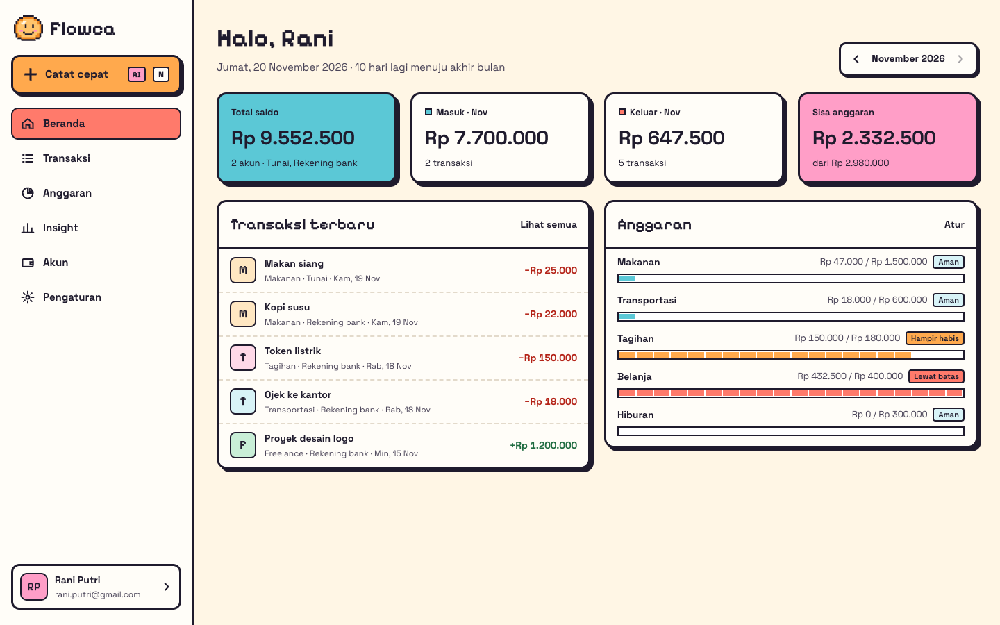
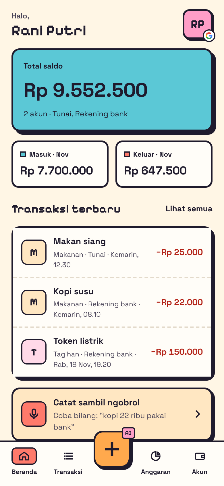
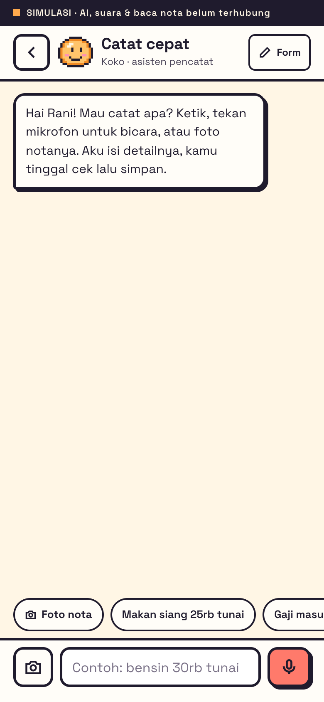
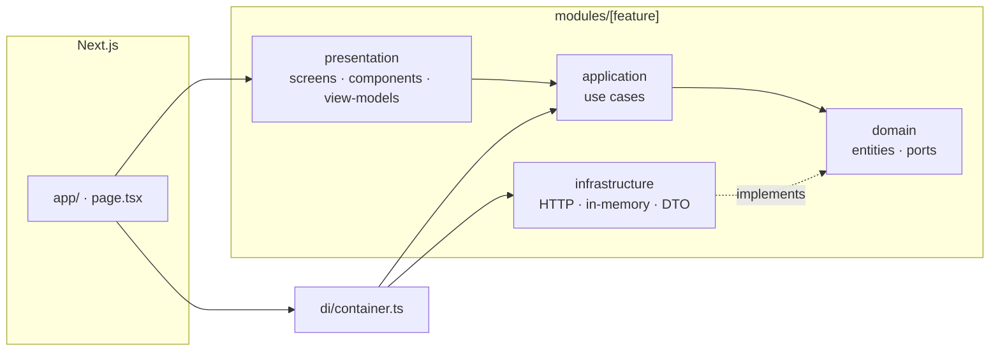

<div align="center">


# Flowca

**A personal finance tracker with a retro pixel-art look.**<br/>
Log income and expenses through a form or a chat, keep an eye on your balance, and stay within your monthly budget.

[](https://github.com/deny-wijaya/flowca-personal-finance-next/actions/workflows/ci.yml)


<br/>



</div>

<br/>

> The app UI is in Indonesian (amounts in Rupiah). The screenshots below use the built-in mock data.

## Screens

Flowca is designed mobile-first at 390px wide. At 1440px it switches to a desktop layout with a sidebar and a Quick Add panel.

<table>
  <tr>
    <td align="center"><br/><sub><b>Home</b></sub></td>
    <td align="center"><br/><sub><b>Transactions</b></sub></td>
    <td align="center"><br/><sub><b>Budget</b></sub></td>
    <td align="center"><br/><sub><b>Quick Add</b></sub></td>
  </tr>
</table>

<details>
<summary><b>More screens</b></summary>
<br/>

| Login (mobile) | Transactions (desktop) |
|---|---|
|  |  |

</details>

## Features

- **Home** shows the total balance across all accounts, this month's income and expenses, recent transactions, and budget progress per category.
- **Transactions** lists entries grouped by day, with search, an income/expense filter, and month-to-month navigation.
- **Budget** shows what's left for the month, a safe daily spending amount, and a status for each category (Safe, Almost out, Over limit).
- **Quick Add** lets you log a transaction by chatting with Koko, for example typing "kopi 22 ribu pakai bank" (coffee, 22k, paid by bank). The parser is rule-based for now; it doesn't use AI yet.
- **Auth** covers login, sign-up, forgot password, reset password, Google sign-in, and onboarding. It currently runs in prototype mode with mock authentication.

## UI style

The look is retro 8-bit: thick outlines, hard offset shadows with no blur, block-style progress bars, and animations that move in steps (`steps()`).

| Element | Value |
|---|---|
| Heading font | [Pixelify Sans](https://fonts.google.com/specimen/Pixelify+Sans) |
| Body font | [Space Grotesk](https://fonts.google.com/specimen/Space+Grotesk) |
| Outline | `3px` in ink, corner radius `8–16px` |
| Shadow | Hard offset, e.g. `4px 4px 0` in ink |
| Touch target | At least `44px` |

**Color palette**


Every visual value lives in [`src/shared/ui/styles/tokens.css`](src/shared/ui/styles/tokens.css), in three layers: primitive (raw values), semantic (meaning, such as `--surface-card` or `--text-danger`), and an `@theme` mapping to Tailwind utilities. Components never hard-code hex colors or `px` values, and ESLint rejects them if they do. Component variants are built with `cva` (for example `tone` and `size`), and the design source for each screen is in the [`design/`](design/) folder.

## Architecture

The code follows clean architecture, organized by feature. Each module in `src/modules/<feature>/` has four layers, and dependencies only point inward.



| Layer | Responsibility |
|---|---|
| `domain` | Entities, business rules, and repository interfaces. Knows nothing about the framework. |
| `application` | Use cases such as `ListTransactions` and `GetBudgetOverview`. Depends only on the domain. |
| `infrastructure` | Repository implementations (HTTP to the backend, or in-memory) with DTO validation in zod. |
| `presentation` | Pure screens, components, view model mappers, and Server Actions. |

Here is what happens on a request to `/dashboard`. `page.tsx` calls use cases through `container`, and `container` picks the mock or HTTP repository based on `DATA_SOURCE`. The mappers in `view-models/` turn the result into display-ready data (Rupiah amounts, dates, +/− signs), and the screen renders it without fetching anything itself. All backend requests run on the server, so `API_BASE_URL` and tokens never reach the browser.

### Locked architecture

The architecture rules are checked automatically, so a future change can't break them without someone noticing.

| Guard | What it checks |
|---|---|
| [ESLint](eslint.config.mjs) | Import direction between layers, pure screens, UI tokens, `process.env` only in `env.ts` |
| [Architecture test](src/architecture.test.ts) | Folder structure, module boundaries, circular dependencies, no `NEXT_PUBLIC_` and no `"use cache"` |
| [Pre-push hook](.githooks/pre-push) | Typecheck, lint, and tests before every `git push` |
| [CI](.github/workflows/ci.yml) | Typecheck, lint, tests, and build on every push and pull request |

The full contract is in [`docs/ARCHITECTURE.md`](docs/ARCHITECTURE.md).

## Tech stack

| Area | Choice |
|---|---|
| Framework | Next.js 16 (App Router, Server Components, Server Actions, React Compiler) |
| UI | React 19, Tailwind CSS v4, `class-variance-authority`, `tailwind-merge` |
| Validation | zod 4 for env, API DTOs, and forms |
| Testing | Vitest |
| Language | TypeScript (strict) |

## Getting started

You need Node.js 20 or later.

```bash
git clone https://github.com/deny-wijaya/flowca-personal-finance-next.git
cd flowca-personal-finance-next
npm install
cp .env.example .env.local
npm run dev
```

Open http://localhost:3200. `DATA_SOURCE` defaults to `mock`, so the app comes with sample data and doesn't need a backend.

To use a real backend, change `.env.local` as shown below and restart the server. No code changes are needed. The endpoint contract is in [`express-personal-finance/docs/API-CONTRACT.md`](../express-personal-finance/docs/API-CONTRACT.md).

```env
DATA_SOURCE=api
API_BASE_URL=http://localhost:4000/api/v1
```

| Script | What it does |
|---|---|
| `npm run dev` | Development server on port 3200 |
| `npm run build` / `npm start` | Production build and server |
| `npm run lint` | ESLint, including the layer boundary rules |
| `npm run typecheck` | TypeScript type check |
| `npm test` | Unit tests and the architecture test |
| `npm run verify` | All of the above in one go; must pass before every commit |

## Project structure

<details>
<summary><b>Show the full tree</b></summary>

```
src/
├── app/                      # Routing: pages call use cases and map results to view models
│   ├── (auth)/               # /login, /register, /forgot-password, /reset-password, /onboarding
│   └── (app)/                # AppShell: /dashboard, /transactions, /budget, /quick-add, ...
├── modules/
│   ├── transaction/          # domain · application · infrastructure · presentation
│   ├── account/              # Balance per account
│   ├── budget/               # Budget per category
│   ├── auth/                 # Authentication (prototype mode) behind the AuthGateway port
│   ├── quick-add/            # Quick Add with a parser behind the QuickEntryParser port
│   └── dashboard/            # Aggregator, presentation layer only
├── shared/
│   ├── ui/styles/            # tokens.css and base.css
│   ├── ui/primitives/        # Button, TextField, Card, Chip, Badge, Icon, Koko, PixelProgress, ...
│   ├── ui/layout/            # AppShell, BottomNav, Sidebar, MonthSwitcher, StatCard
│   ├── lib/                  # cn(), format, month
│   ├── config/env.ts         # Env validation (server-only)
│   └── infrastructure/http/  # HttpClient and HttpError
├── di/container.ts           # Composition root: picks mock or API
└── architecture.test.ts      # Architecture lock
design/                       # Design source for each screen (*.dc.html)
docs/                         # PRD, UI PRD, and the architecture contract
```

</details>

## Docs

The docs below are written in Indonesian.

- [`docs/PRD.md`](docs/PRD.md) covers product requirements and the API contract.
- [`docs/PRD-UI-Flowca.md`](docs/PRD-UI-Flowca.md) covers the UI spec and design tokens.
- [`docs/ARCHITECTURE.md`](docs/ARCHITECTURE.md) covers the architecture rules and how to add a new feature.
