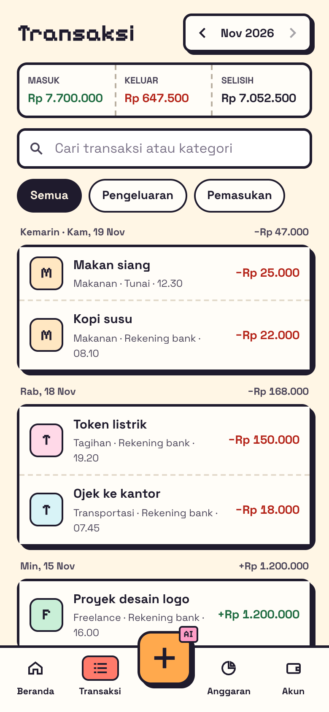
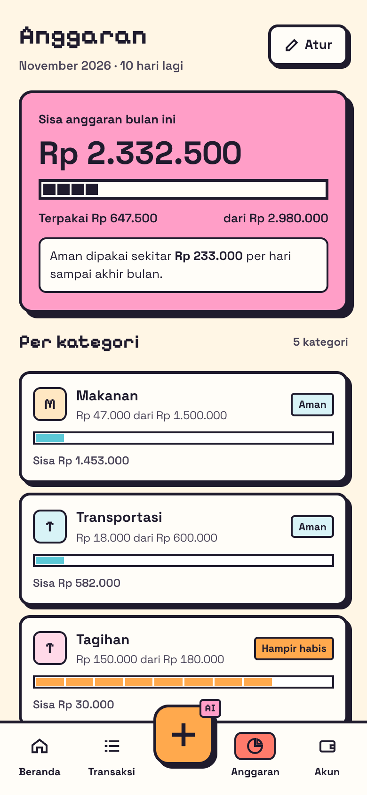
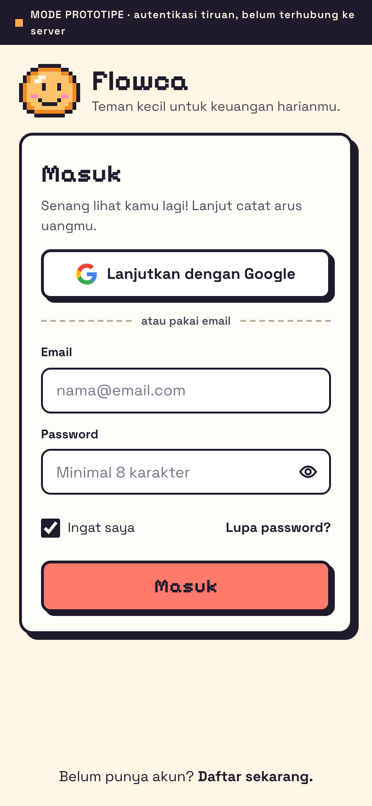
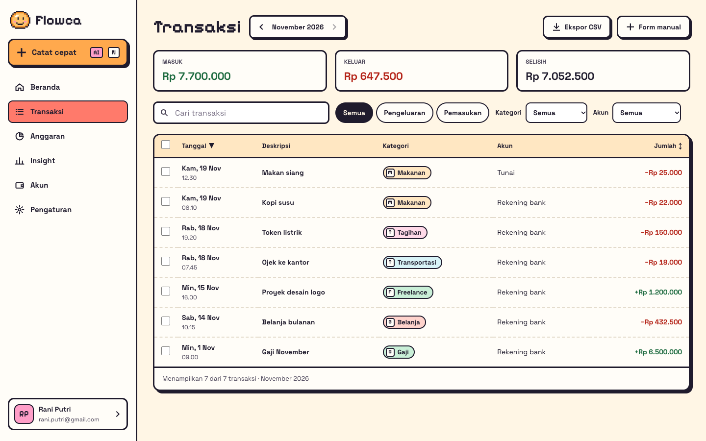

<div align="center">


# Flowca

**Aplikasi pencatat keuangan pribadi dengan tampilan retro pixel-art.**<br/>
Catat pemasukan dan pengeluaran lewat form atau chat, pantau saldo, dan jaga anggaran bulanan.

[](https://github.com/deny-wijaya/flowca-personal-finance-next/actions/workflows/ci.yml)


<br/>


</div>

<br/>

## Tampilan

Flowca dirancang mobile-first di lebar 390px, lalu melebar menjadi layout desktop dengan sidebar dan panel Catat cepat di lebar 1440px.

<table>
  <tr>
    <td align="center"><br/><sub><b>Beranda</b></sub></td>
    <td align="center"><br/><sub><b>Transaksi</b></sub></td>
    <td align="center"><br/><sub><b>Anggaran</b></sub></td>
    <td align="center"><br/><sub><b>Catat cepat</b></sub></td>
  </tr>
</table>

<details>
<summary><b>Lihat layar lainnya</b></summary>
<br/>

| Login (mobile) | Transaksi (desktop) |
|---|---|
|  |  |

</details>

## Fitur

- **Beranda** menampilkan total saldo semua akun, pemasukan dan pengeluaran bulan berjalan, transaksi terbaru, dan progres anggaran per kategori.
- **Transaksi** berisi daftar per hari dengan pencarian, filter pemasukan atau pengeluaran, dan navigasi antar bulan.
- **Anggaran** menunjukkan sisa anggaran bulan ini, batas aman pemakaian per hari, dan status tiap kategori (Aman, Hampir habis, Lewat batas).
- **Catat cepat** memungkinkan pencatatan lewat chat bersama Koko, misalnya mengetik "kopi 22 ribu pakai bank". Saat ini parser-nya masih berbasis aturan (simulasi), belum memakai AI.
- **Autentikasi** mencakup login, daftar, lupa password, reset password, login Google, dan onboarding. Saat ini masih mode prototipe dengan autentikasi tiruan.

## Gaya UI

Tampilannya memakai gaya retro 8-bit: outline tebal, bayangan offset tanpa blur, progress bar berbentuk blok, dan animasi yang bergerak per langkah (`steps()`).

| Elemen | Nilai |
|---|---|
| Font judul | [Pixelify Sans](https://fonts.google.com/specimen/Pixelify+Sans) |
| Font isi | [Space Grotesk](https://fonts.google.com/specimen/Space+Grotesk) |
| Outline | `3px` warna ink, sudut membulat `8–16px` |
| Bayangan | Offset keras, misalnya `4px 4px 0` warna ink |
| Ukuran sentuh | Minimal `44px` |

**Palet warna**


Semua nilai visual hanya didefinisikan di [`src/shared/ui/styles/tokens.css`](src/shared/ui/styles/tokens.css) dalam tiga lapis: primitive (nilai mentah), semantic (makna seperti `--surface-card` atau `--text-danger`), dan pemetaan `@theme` ke utility Tailwind. Komponen tidak pernah menulis hex atau `px` langsung, dan ESLint menolak kalau itu terjadi. Varian komponen dibuat dengan `cva` (misalnya `tone` dan `size`), dan sumber desain tiap layar ada di folder [`design/`](design/).

## Arsitektur

Kode disusun dengan clean architecture per fitur. Setiap modul di `src/modules/<fitur>/` punya empat layer, dan arah dependency hanya boleh ke dalam.


| Layer | Tanggung jawab |
|---|---|
| `domain` | Entity, aturan bisnis, dan interface repository. Tidak mengenal framework. |
| `application` | Use case seperti `ListTransactions` dan `GetBudgetOverview`. Hanya bergantung pada domain. |
| `infrastructure` | Implementasi repository (HTTP ke backend atau in-memory) beserta validasi DTO dengan zod. |
| `presentation` | Screen murni, komponen, mapper view model, dan Server Action. |

Alur satu request ke `/dashboard` berjalan seperti ini. `page.tsx` memanggil use case lewat `container`, `container` memilih repository mock atau HTTP berdasarkan `DATA_SOURCE`, hasilnya dipetakan oleh mapper di `view-models/` menjadi data siap tampil (Rupiah, tanggal, tanda +/−), lalu screen merender data itu tanpa mengambil data sendiri. Semua request ke backend terjadi di server, jadi `API_BASE_URL` dan token tidak pernah terkirim ke browser.

### Arsitektur yang dikunci

Aturan arsitektur dijaga otomatis supaya perubahan berikutnya tidak bisa melanggarnya tanpa ketahuan.

| Pengaman | Yang dicek |
|---|---|
| [ESLint](eslint.config.mjs) | Arah import antar layer, screen tetap murni, token UI, `process.env` hanya di `env.ts` |
| [Architecture test](src/architecture.test.ts) | Struktur folder, batas antar modul, dependency melingkar, larangan `NEXT_PUBLIC_` dan `"use cache"` |
| [Pre-push hook](.githooks/pre-push) | Typecheck, lint, dan test sebelum `git push` |
| [CI](.github/workflows/ci.yml) | Typecheck, lint, test, dan build di setiap push dan pull request |

Kontrak lengkapnya ada di [`docs/ARCHITECTURE.md`](docs/ARCHITECTURE.md).

## Tech stack

| Area | Pilihan |
|---|---|
| Framework | Next.js 16 (App Router, Server Components, Server Actions, React Compiler) |
| UI | React 19, Tailwind CSS v4, `class-variance-authority`, `tailwind-merge` |
| Validasi | zod 4 untuk env, DTO API, dan form |
| Test | Vitest |
| Bahasa | TypeScript strict |

## Mulai

Kamu butuh Node.js 20 atau lebih baru.

```bash
git clone https://github.com/deny-wijaya/flowca-personal-finance-next.git
cd flowca-personal-finance-next
npm install
cp .env.example .env.local
npm run dev
```

Buka http://localhost:3200. Secara default `DATA_SOURCE=mock`, jadi aplikasi langsung berisi data contoh tanpa perlu backend.

Untuk memakai backend asli, ubah `.env.local` seperti di bawah, lalu restart server. Tidak ada kode yang perlu diubah. Kontrak endpoint ada di [`docs/PRD.md`](docs/PRD.md) bagian 8.4.

```env
DATA_SOURCE=api
API_BASE_URL=http://localhost:4000/api/v1
```

| Script | Fungsi |
|---|---|
| `npm run dev` | Development server di port 3200 |
| `npm run build` / `npm start` | Build dan jalankan production |
| `npm run lint` | ESLint, termasuk aturan batas antar layer |
| `npm run typecheck` | Cek tipe TypeScript |
| `npm test` | Unit test dan architecture test |
| `npm run verify` | Semua pemeriksaan di atas sekaligus, wajib lolos sebelum commit |

## Struktur folder

<details>
<summary><b>Lihat struktur lengkap</b></summary>

```
src/
├── app/                      # Routing: page memanggil use case lalu memetakan ke view model
│   ├── (auth)/               # /login, /register, /forgot-password, /reset-password, /onboarding
│   └── (app)/                # AppShell: /dashboard, /transactions, /budget, /quick-add, ...
├── modules/
│   ├── transaction/          # domain · application · infrastructure · presentation
│   ├── account/              # Saldo per akun
│   ├── budget/               # Anggaran per kategori
│   ├── auth/                 # Autentikasi (mode prototipe) di balik port AuthGateway
│   ├── quick-add/            # Catat cepat dengan parser di balik port QuickEntryParser
│   └── dashboard/            # Agregator, hanya punya presentation
├── shared/
│   ├── ui/styles/            # tokens.css dan base.css
│   ├── ui/primitives/        # Button, TextField, Card, Chip, Badge, Icon, Koko, PixelProgress, ...
│   ├── ui/layout/            # AppShell, BottomNav, Sidebar, MonthSwitcher, StatCard
│   ├── lib/                  # cn(), format, month
│   ├── config/env.ts         # Validasi env (server-only)
│   └── infrastructure/http/  # HttpClient dan HttpError
├── di/container.ts           # Composition root: memilih mock atau API
└── architecture.test.ts      # Pengunci arsitektur
design/                       # Sumber desain tiap layar (*.dc.html)
docs/                         # PRD, PRD UI, dan kontrak arsitektur
```

</details>

## Dokumen

- [`docs/PRD.md`](docs/PRD.md) berisi kebutuhan produk dan kontrak API.
- [`docs/PRD-UI-Flowca.md`](docs/PRD-UI-Flowca.md) berisi spesifikasi UI dan design token.
- [`docs/ARCHITECTURE.md`](docs/ARCHITECTURE.md) berisi aturan arsitektur dan cara menambah fitur baru.
