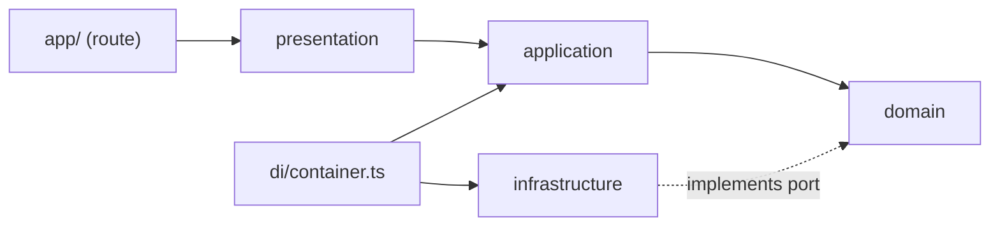

# Arsitektur Flowca

Dokumen ini adalah kontrak arsitektur project. Setiap aturan di bawah dijaga otomatis oleh tool, jadi pelanggaran langsung gagal di editor, saat `git push`, atau di CI. Kalau sebuah aturan terasa menghalangi, ubah dokumen ini dan pengamannya dalam satu PR yang sama, jangan cuma melewatinya.

## Lapisan per modul

Setiap fitur adalah satu modul di `src/modules/<fitur>/` dengan empat layer. Arah dependency hanya boleh ke dalam.

| Layer | Isi | Boleh import | Dilarang import |
|---|---|---|---|
| `domain/` | Entity, aturan bisnis, interface repository (port) | `shared/domain` | application, infrastructure, presentation, `next`, `react`, `zod` |
| `application/` | Use case | domain | infrastructure, presentation, `next`, `react` |
| `infrastructure/` | Repository HTTP dan in-memory, DTO + schema zod | domain, `shared/infrastructure` | presentation, `@/di` |
| `presentation/` | Server Action, `screens/`, `components/`, `view-models/` | application (tipe), domain, `shared/ui` | infrastructure, `@/di`, env |

Isi `presentation/` dibatasi tiga subfolder:

- `screens/` adalah komponen murni. Input-nya view model, output-nya markup dan callback. Tidak ada `fetch` dan tidak ada akses repository.
- `components/` adalah komposit milik modul (misalnya `TransactionRow`, `BudgetRow`) yang menerima data yang sudah siap tampil.
- `view-models/` berisi mapper dari entity ke data tampilan, termasuk format Rupiah, tanggal, dan tanda +/−. Mapper wajib punya unit test.

File lain di `presentation/` hanya `actions.ts` (Server Action) dan schema form.

## Aturan lintas modul

- `src/app/**/page.tsx` adalah satu-satunya tempat yang memanggil use case lewat `container`, lalu memetakan hasilnya ke view model. `presentation/actions.ts` juga boleh memakai `container`.
- `src/di/container.ts` adalah satu-satunya file yang memilih implementasi konkret (`DATA_SOURCE=mock|api`). Infrastructure modul lain tidak boleh di-import dari mana pun selain file ini dan file test.
- Dependency antar modul tidak boleh melingkar. Contoh: `budget` boleh memakai `transaction`, tapi `transaction` tidak boleh balik memakai `budget`. `dashboard` adalah modul agregator, jadi tidak ada modul lain yang boleh bergantung padanya.
- `src/shared/` bersifat generik dan tidak boleh import `modules/`, `di/`, atau `app/`.

## Aturan data dan keamanan

- Hanya `src/shared/config/env.ts` yang membaca `process.env`, dan env divalidasi dengan zod saat server start.
- Tidak ada env `NEXT_PUBLIC_`. Request ke backend hanya dari server (Server Component dan Server Action), jadi `API_BASE_URL` dan token tidak pernah sampai ke browser.
- Data keuangan bersifat per user, jadi `"use cache"` dilarang. Section yang mengambil data memanggil `connection()` dan dibungkus `<Suspense>`.
- `env.ts` dan `container.ts` diawali `import "server-only"`.

## Aturan UI

- Semua nilai visual (warna, ukuran huruf, border, radius, bayangan) berasal dari `src/shared/ui/styles/tokens.css`. Hex dan nilai arbitrer `px` di `className`, `cn()`, atau `cva()` ditolak ESLint.
- Varian visual lewat props `cva` (`tone`, `size`). `className` dari luar hanya untuk layout.
- Struktur dan perilaku tiap layar mengikuti `design/*.dc.html`. Spesifikasi lengkapnya ada di [`PRD-UI-Flowca.md`](PRD-UI-Flowca.md).

## Struktur folder yang dikunci

- `src/` hanya berisi `app/`, `di/`, `modules/`, `shared/`, dan `proxy.ts`. Proxy (dulu bernama middleware) hanya melakukan pengecekan cepat cookie login sebelum halaman dirender; pemeriksaan token yang sesungguhnya tetap di backend.
- `src/shared/` hanya berisi `config/`, `domain/`, `infrastructure/`, `lib/`, `ui/`.
- Setiap modul hanya berisi folder `domain/`, `application/`, `infrastructure/`, `presentation/`. Modul boleh tidak punya semua layer (misalnya `dashboard` hanya punya `presentation`).

## Siapa yang menjaga aturan ini

| Pengaman | Lokasi | Yang dicek | Kapan jalan |
|---|---|---|---|
| ESLint | `eslint.config.mjs` | Arah import per layer, kemurnian screen, token UI, `process.env` | Di editor dan `npm run lint` |
| Architecture test | `src/architecture.test.ts` | Struktur folder, batas antar modul, siklus, `NEXT_PUBLIC_`, `"use cache"`, `server-only` | `npm test` |
| Pre-push hook | `.githooks/pre-push` | Typecheck, lint, test | Setiap `git push` |
| CI | `.github/workflows/ci.yml` | Typecheck, lint, test, build | Setiap push ke `main` dan setiap PR |

Pre-push hook aktif otomatis setelah `npm install` lewat script `prepare`, yang menjalankan `git config core.hooksPath .githooks` khusus untuk repo ini.

## Menambah fitur baru

Contoh berikut memakai fitur "Tagihan rutin" (`recurring`).

1. Buat `src/modules/recurring/domain/` berisi entity `RecurringBill` dan interface `RecurringBillRepository`.
2. Buat use case di `application/`, misalnya `ListUpcomingBills`, beserta unit test dengan repository in-memory.
3. Buat `InMemoryRecurringBillRepository` dan `HttpRecurringBillRepository` di `infrastructure/`, lengkap dengan schema DTO zod.
4. Daftarkan use case di `src/di/container.ts`.
5. Buat mapper di `presentation/view-models/`, screen di `presentation/screens/`, lalu route di `src/app/(app)/recurring/page.tsx`.
6. Jalankan `npm run verify` sebelum commit.
